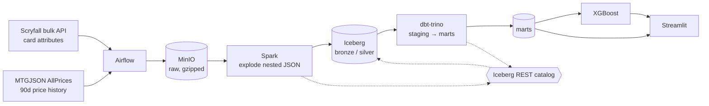

# v2 Architecture

> Draft. Rewrite anything here in your own words — if a sentence doesn't sound like you,
> you won't be able to defend it in an interview.

## The problem with v1

v1 worked, but it had four weaknesses I could not defend:

1. **The grain was wrong.** One row per card. After filtering 530k Scryfall cards down to
   ~79k rows, the dataset fit comfortably in pandas — so reaching for Spark was decorative,
   not necessary.
2. **No time dimension.** A snapshot of today's prices can't answer any question that starts
   with "when" or "how did this change".
3. **No dimensional model.** Snowflake held tables, but not a star schema.
4. **Not reproducible.** No Docker, no CI, no meaningful tests.

## The central change: re-grain the fact table

v1's fact table was one row per card. That is a *dimension* table wearing a fact table's
clothes — it describes things, it doesn't measure events.

v2's grain is:

```
card_uuid × game_format × provider × list_type × finish × price_date
```

MTGJSON publishes `AllPrices.json`: 90 days of daily price history, free, no auth, keyed by
card UUID. Exploding that nesting into the grain above turns one download into tens of
millions of rows.

Two things follow from that single decision:

- Spark becomes **necessary** rather than decorative. Partitioning, file sizing and shuffle
  behaviour start to matter, which means benchmarks become meaningful.
- I get a real **time series**, which unlocks the modelling story below.

## The second unlock: format legality changes over time

Magic cards get banned and unbanned in Standard, Modern and Commander. So "what was this
card's legality on the day its price spiked?" is a question you can only answer if the card
dimension tracks history.

That is a **Type 2 slowly changing dimension** — `valid_from`, `valid_to`, `is_current` — and
it's the centrepiece of the model. Not a contrived tutorial example: the data genuinely
changes and the question genuinely needs it.

## The one idea behind the stack

v1 ran: S3 (files) → Spark (transform) → Snowflake (store *and* query).

Snowflake does two jobs at once: it holds the data and it answers the SQL. Those are bundled,
and the data lives in a proprietary format only Snowflake can read.

The lakehouse idea is to **unbundle those two jobs**: keep the data as open files in cheap
object storage, add a thin metadata layer that makes those files behave like real tables, and
then point any query engine at them.

Every component below exists to serve that one idea.

## The components

| Component | What it actually does |
|---|---|
| **MinIO** | S3, running locally. A bucket you put files in, speaking the same API — code says `s3a://...` and doesn't know it isn't AWS. |
| **Parquet** | The *file* format. Columnar, compressed. Same as v1. |
| **Apache Iceberg** | The *table* format. Metadata that says "right now this table is exactly these N files". |
| **Iceberg REST catalog** | The phone book: maps table names to metadata locations. Spark and Trino ask the same one, which is how they see the same tables. |
| **Spark** | Heavy compute. Its job here is flattening a multi-GB deeply-nested JSON. |
| **Trino** | A SQL engine with no storage of its own. Pure query brain, pointed at Iceberg. |
| **dbt** | Not an engine. It orders a folder of SELECT statements by dependency, builds them as tables, and adds tests, docs and lineage. It hands the SQL to Trino to run. |
| **Airflow** | The scheduler. Same as v1, but with real backfills. |
| **Postgres** | Airflow's own bookkeeping (which DAG ran when). Card data never touches it. |

### Why Iceberg — the part worth understanding

A folder of Parquet files is not a table:

- Write 40 files and someone queries mid-write, they see a broken half-state.
- Write bad data and there is no undo.
- Rename a column and you rewrite everything.
- Update 100 rows and you can't — you can only replace whole files.

Iceberg keeps a metadata layer alongside the Parquet. That metadata says *as of right now,
this table is exactly these 3,200 files*. Writing means writing new files, then atomically
swapping in a new "these are the files now" pointer. A reader sees the old list or the new
one, never a mix.

Parquet files are the pages; Iceberg is the table of contents that says which pages are
currently the book.

That one mechanism buys:

- **atomic writes** — no half-written table
- **time travel** — old pointers are kept
- **schema evolution** — columns tracked by ID, not position
- **`MERGE INTO`** — real upserts, which is what makes re-running a job idempotent
- **compaction** — rewrite 3,200 small files into 48 large ones, swap the pointer, queries
  get faster

## Diagram



## Design decisions and tradeoffs

| Decision | Chose | Over | Why |
|---|---|---|---|
| Object store | MinIO | AWS S3 | $0 and identical `s3a://` API. Swapping back to real S3 is a config change, not a rewrite. |
| Table format | Iceberg | bare Parquet | Atomic writes, time travel, `MERGE INTO`, compaction. Without these, "re-run the job" is not safe. |
| Query engine | Trino | Snowflake | Free, open source, and the storage/compute split is the whole point of the rewrite. |
| Transform | Spark + dbt | Spark alone | Spark for the heavy distributed flattening; dbt for modelling, tests and lineage. Different jobs. |
| Airflow metadata DB | Postgres | SQLite | SQLite can't do concurrent scheduling; v1's `airflow standalone` was a learning setup, not a real one. |

**Known risk:** if Trino plus dbt-trino costs more than half a day of configuration, the
fallback is dbt-duckdb reading Iceberg through DuckDB's `iceberg` extension. That tradeoff
gets documented here rather than hidden.

## What I'd change at production scale

<!-- Fill this in at the end, once you've hit the real limits. Candidates:
     managed catalog instead of a single REST container, S3 instead of MinIO,
     autoscaling Spark, separate warehouses per workload, alerting on the DQ tables. -->
